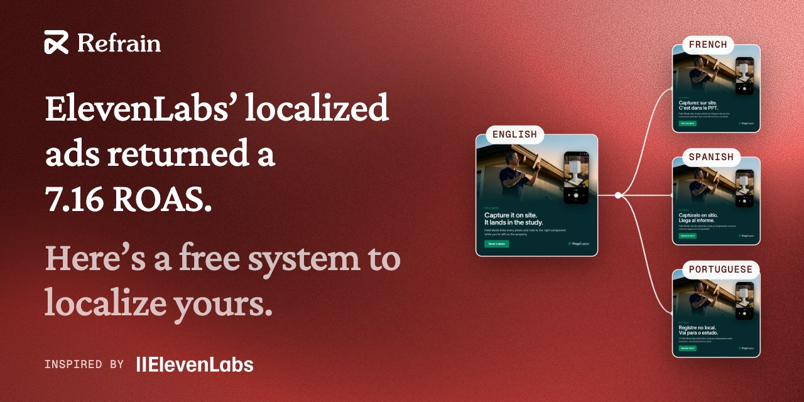
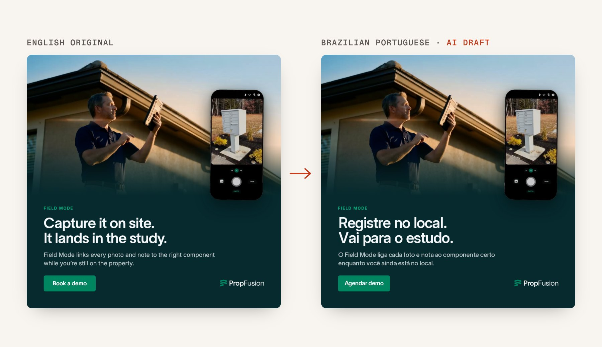

# Ad localization for Claude Code

Turn your English text, image and video ads into drafts for other languages, ready for a native speaker to
review. Free and open source.

Built by [Jovan Babovic](https://www.linkedin.com/in/jovanbabovic/) at
[Refrain](https://refrain.team/?utm_source=github&utm_medium=readme&utm_campaign=ad-localization&utm_content=top).
Read how the test run went in the
[write-up](https://refrain.team/builds/ad-localization-workflow?utm_source=github&utm_medium=readme&utm_campaign=ad-localization&utm_content=top).

ElevenLabs' paid marketing team is four English-speaking people. They run their ads in seven languages.
ElevenLabs reports those localized campaigns generated $3.78M in incremental conversion value at a 7.16 ROAS
([their write-up](https://elevenlabs.io/blog/how-we-solved-multilingual-advertising-internally-and-why-we-are-launching-it-as-ads-engine),
[Google's case study](https://business.google.com/us/accelerate/ads-impact-awards/elevenlabs/)).
This repo rebuilds the repetitive part of that work for your own ads. It's an independent project, not
affiliated with or endorsed by ElevenLabs. Their results are their own, and this repo makes no promise about yours.



In our test, 6 text ads, 2 image ads and 1 video went into French, Spanish and Brazilian Portuguese in 31
minutes, from a fresh copy of this repo to a finished kit. Claude Code reported $8.87 of Claude usage. ElevenLabs
used 1,412 credits, about $0.28. You can
[watch the dubbed videos](https://refrain.team/builds/ad-localization-workflow?utm_source=github&utm_medium=readme&utm_campaign=ad-localization&utm_content=video#voice)
in the write-up.

Every output is labeled **AI draft, not yet reviewed by a native speaker**. Nothing gets uploaded or published.
Have someone who speaks the language read the kit before anything runs.

## Before you start

- **Claude Code** on a paid Claude plan: Pro, Max, Team, Enterprise or Console
  ([install it](https://code.claude.com/docs/en/setup)).
- **Python 3.9 or newer.** The `python3` that comes with macOS works.
- **A Mac** for image ads and text on screen in videos. They use Apple's built-in text recognition. Text ads work
  on any computer.
- **For video ads:** [FFmpeg](https://ffmpeg.org/download.html), a free video tool, and a paid ElevenLabs plan.
  ElevenLabs' free plan "does not include a commercial license and cannot be used for any commercial purpose"
  ([ElevenLabs help](https://elevenlabs.io/docs/help-center/legal/can-i-publish-the-content-i-generate-on-the-platform)).

`/setup` checks your computer and tells you what's missing.

## Quickstart (setup takes about 5 minutes)

Paste this into Claude Code:

```text
I want to try the free ad-localization project for Claude Code.
1. Clone https://github.com/jovan-babovic/ad-localization into this folder.
2. Read its README.md. Tell me in plain words what it does and what my computer needs.
3. Tell me how to start Claude Code inside the ad-localization folder, so I can type /setup.
```

Or do it yourself in Terminal:

```sh
git clone https://github.com/jovan-babovic/ad-localization
cd ad-localization
claude
```

If your Mac asks to install developer tools, say yes. Image ads need them too. The first time, Claude Code asks
whether you trust this folder. Say yes. The job's own commands are pre-approved in `.claude/settings.json`.
Claude asks before running anything else.

Then, inside Claude Code:

1. Type **`/setup`**. Claude asks one question at a time. It covers your company and site, who buys, where you
   advertise and which markets you want. It asks how to address readers in each language (French "vous" or
   "tu", Spanish "tú" or "usted", Brazilian Portuguese "você"). It also asks which names must never be
   translated and which claims need care. Then it writes `config/` and offers to install Pillow and NumPy, two
   small add-ons that image and video ads need.
2. Drop your ads into **`input/`**. Text ads go in a CSV with the columns `ad, platform, field, text`
   (see [`examples/input/text-ads.csv`](examples/input/text-ads.csv)). Image ads can be `.png`, `.jpg` or
   `.webp`. Video ads can be `.mp4` or `.mov`.
3. Type **`/localize`**. To do only some markets, add their language codes: `/localize fr,es`.
4. Open the kit. Claude tells you where it is (`output/<date-time>/kit/index.html`). Double-click it in Finder, or
   ask Claude to open it. You get one page and one CSV per language, for copying approved text into your ad
   platform.

Want to see it work first? Type **`/localize example`**. It runs the Field Mode ads from the
[write-up](https://refrain.team/builds/ad-localization-workflow?utm_source=github&utm_medium=readme&utm_campaign=ad-localization&utm_content=example):
6 text ads, 2 image ads and 1 video. Your images will use your Mac's fonts, so they won't match the write-up
exactly.

### Your ElevenLabs API key (video ads only)

Create a key at [elevenlabs.io/app/settings/api-keys](https://elevenlabs.io/app/settings/api-keys). Then open a new
Terminal window, go to the ad-localization folder (Claude can tell you the exact `cd` command) and run:

```sh
python3 scripts/save_key.py
```

Paste the key when it asks. It stays hidden and never passes through the chat. It's saved in `.env`, a file only
you can read, and it never goes into a commit.

## What happens in a run

1. **Prepare.** Every piece of text is listed with its platform's character limit, for example Google headline
   30 or LinkedIn introductory text 150 recommended. The limits live in
   [`scripts/limits.json`](scripts/limits.json), with the official source pages and the date they were checked.
2. **Read the media.** Claude reads the text inside your images and the frames of your videos. It takes the
   voice-over from a transcript you provide, or from a paid transcription if you say yes.
3. **Translate.** Claude drafts each line in your session, in the tone you set for that market. Brand names stay
   as they are, and claims stay exactly as strong as the English. When a translation is too long, Claude also
   writes a short version and says what it leaves out.
4. **Check.** A script counts characters the way each platform does. It also checks that locked names and
   numbers survived, and that the same English line wasn't translated two different ways.
5. **Blind back-translation.** A separate Claude sees only the translation and turns it back into English. It has
   no tools and no access to your files. It never saw the original, so it can't fill gaps from memory. Claude then
   compares each one with your English and notes where the meaning moved.
6. **Media.** Image ads: the English text is erased and the translation is set in the same box. The rest of the
   design stays as it was, and a button label stays centered in its button. Each box gets a character budget
   before translating, so long lines get a short version up front. Text that still doesn't fit is flagged for a
   shorter line, never squashed. Video ads: the music is split from the voice. A ready-made ElevenLabs voice
   records the translated script. It never clones your speaker. Each sentence starts where the English one did,
   over the original music. Text on screen is redrawn in every frame it shows, following its zoom, typing and
   fade. Those frames are then read back to catch leftover English.
7. **Kit.** The review pages, a CSV per language, and every piece of evidence behind them.

Before every paid step, Claude shows you the estimate in credits and waits for your yes.

## What runs on your computer

- Without asking, Claude can run the job's own scripts, the tests, the Pillow and NumPy install, and a few checks
  such as `which` and `ffprobe`. It can also edit files in `output/` and `config/`. The full list is in
  [`.claude/settings.json`](.claude/settings.json).
- Claude is blocked from reading `.env`, where your key is saved, and from running the key script.
- The blind back-translation starts a separate Claude with no tools, no MCP servers, no settings and no saved
  session ([`scripts/blind.py`](scripts/blind.py)). It sees only the translated text.
- Your ads leave your computer in two ways only. Claude reads them in your Claude Code session. For video steps
  you approve, the audio and the translated script go to ElevenLabs.

## What it costs

- **Claude.** The work runs in your Claude Code session and counts toward your plan's usage. Our test run
  reported $8.87, on Claude Opus. The blind back-translation runs on Claude Sonnet and was $0.18 of that.
- **ElevenLabs (video only).** Our test used 1,412 credits. That's about $0.28 at the Starter plan's $6 for 30,000
  credits a month ([pricing](https://elevenlabs.io/pricing), checked 2026-10-14). Splitting the music from the
  31.5-second video took 394 credits, once for all languages. Each language's voice took 160 to 181 credits. The
  1,412 also covers a Spanish take we didn't use and a second recording of French and Portuguese. The estimate
  Claude shows before each step uses ElevenLabs' published rates: 1 credit per character for the voice and a
  ceiling of 900 credits a minute for the music split. So it usually comes out higher than the bill.
- Before any paid call, the job checks three things. Your plan must be active, automatic overage billing must be
  off, and at least 10,000 credits must stay in reserve. If any check fails, it stops and nothing is spent.

## What it does not do

- It doesn't replace a native speaker. The checks catch length, names, numbers and meaning drift. They can't tell
  you whether a line sounds natural to a local buyer.
- It doesn't upload or publish anything. You copy approved text into your ad platforms yourself.
- It makes no performance claims. It writes drafts. Whether they convert depends on your market, offer and budget.
- It never clones a voice. Video dubs use ready-made ElevenLabs voices only.
- It doesn't build landing pages, check legal wording market by market, or show you the ad platform's preview.

## Folder map

```
.claude/skills/setup/         /setup: the interview that writes config/
.claude/skills/localize/      /localize: the job
CLAUDE.md                     the rules Claude follows in this folder
config/                       your company, markets and glossary (ignored by git)
input/                        your ads (ignored by git)
output/                       one folder per run, with kit/ inside (ignored by git)
examples/                     sample config and ads (Field Mode by PropFusion)
docs/                         the images in this README
scripts/job.py                check config, list what to translate, check drafts
scripts/blind.py              blind back-translation
scripts/kit.py                the review kit
scripts/voice.py              ElevenLabs: voices, transcription, music split, recording
scripts/video.py              FFmpeg: frames, audio, mixing, on-screen text
scripts/reset_image_text.py   erase and re-set text in image ads (with scripts/ocr_lines.swift)
scripts/save_key.py           save your ElevenLabs key without showing it
scripts/limits.json           platform character limits and their sources
requirements.txt              Pillow and NumPy, for image ads and text on screen
tests/                        .venv/bin/python -m unittest discover tests
```

## Who made this

Jovan Babovic built this at
[Refrain](https://refrain.team/?utm_source=github&utm_medium=readme&utm_campaign=ad-localization&utm_content=footer).
Refrain builds AI systems that take the busywork off B2B marketing teams. The full test run is in the
[write-up](https://refrain.team/builds/ad-localization-workflow?utm_source=github&utm_medium=readme&utm_campaign=ad-localization&utm_content=footer).

Found a bug or a confusing step? [Open an issue](https://github.com/jovan-babovic/ad-localization/issues).
Want this running on your team's ads?
[Book a call](https://refrain.team/book?utm_source=github&utm_medium=readme&utm_campaign=ad-localization&utm_content=footer).

## License

The code is MIT licensed ([LICENSE](LICENSE)). The example ads in `examples/input/` belong to PropFusion, Jovan's
own company, and aren't covered by it ([examples/README.md](examples/README.md)).
